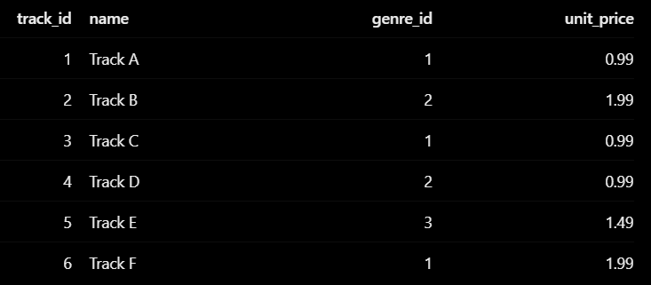
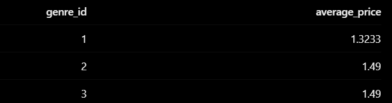
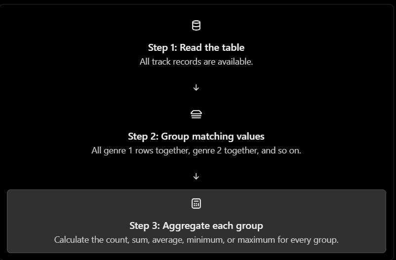

## **Grouping and Filtering (`GROUP BY` | `HAVING`)**

### **Lesson 1 - SQL `GROUP BY`**

#### **1. First, understand the problem**
Imagine our `track` table contains these sample records:


Suppose the manager asks:

"What is the average track price for each genre?"

W coould run a separate query for every genre, but that would be inefficient. Instead, use `GROUP BY`.

```SQL
SELECT genre_id, AVG(unit_price) AS average_price
FROM track
GROUP BY genre_id
ORDER BY genre_id;
```
The result from our illustrative sample data would be:


#### **2. What does `GROUP BY` do?**
Think of it as three operations:


#### **3. Combine `GROUP BY` with different aggregate functions**

We aren't limited to `AVG()`.

**Example A: Count tracks in each genre**.

```SQL
SELECT 
    genre_id,
    COUNT(*) AS track_count
FROM track
GROUP BY genre_id
ORDER BY genre_id;
```
This tells how many tracks does each genre contains.

**Example B: Find the most expensive track price in each genre**

```SQL
SELECT
    genre_id,
    MAX(unit_price) AS highest_price
FROM track
GROUP BY genre_id
ORDER BY genre_id;
```
This tells highest price of a track does each genre contains.

#### **4. The important rule: `SELECT` and `GROUP BY`**

Consider this query:
```SQL
SELECT genre_id, unit_price, AVG(unit_price)
FROM track
GROUP BY genre_id;
```

In PostgreSQL, this query is invalid because `unit_price` is neither grouped nor aggregated. Each genre may contain multiple different prices, so SQL cannot choose one price to represent the entire group.

A reliable rule is:

In a grouped query, every selected expression must generally either:
- Appear in the `GROUP BY` clause, or
- Be calculated using an aggregate function.

#### **Practice Question - 1**

**[Click here](../Practice_queries/Grouping_and_filtering.sql)**
