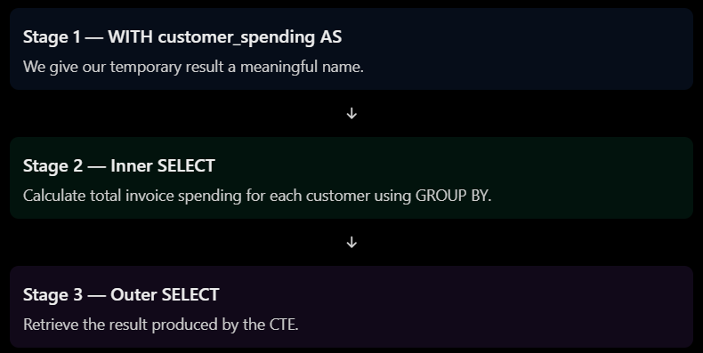
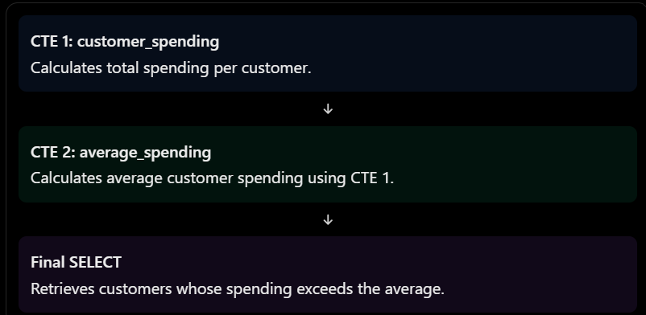

<h1 style="text-align: center;"><b>CTEs (Common Table Expressions)</b></h1>

This is an important step in our SQL journey. So far, we've learned how to retrieve data, combine tables, aggregate information, and use subqueries. CTEs will help us organize all that logic into readable, manageable pieces.

And there's a practical reason to learn them: professional analysts frequently work with SQL queries containing multiple stages of data transformation.

### **1. What is a CTE?**

A Common Table Expression (CTE) is a temporary, named result set that we define at the beginning of a SQL statement using the `WITH` keyword.

Think of it as creating a temporary table-like result that exists only while that particular SQL statement executes.

**Basic Syntax:**
```SQL
WITH cte_name AS (
    SELECT
        column1,
        column2,
    FROM table_name
    WHERE condition
)

SELECT *
FROM cte_name;
```

Let's understand why this exists.

### **2. Why do we need CTEs?**

Imagine we're working as a data analyst for online music store.

Our manager asks:

_"Identify customers whose total spending is greater than $40."_

We need to:
1. Retrieve customer invoices.
2. Calculate total spending for each customer.
3. Identify cutomers speding more than $40.

We could write everything in one query:
```SQL
SELECT
    c.customer_id,
    c.first_name,
    SUM(i.total) AS total_spending
FROM customer AS c
JOIN invoice As i
    ON c.customer_id = i.customer_id
GROUP BY c.customer_id, c.first_name
HAVING SUM(i.total) > 40;
```
This works perfectly.

But imagine the analysis becomes more complicated. Perhaps we need to calculate customer spending first, then calculate the average spending across all customers, and finally identify customers above that average.

A long query can become difficult to read and maintain.

**CTEs solve this readability problem by allowing us to divide complex SQL logic into smaller stages.**

### **3. Understanding how a CTE works**

Let's build our first CTE using the Chinook database.

Business question:

_"Calculate the total spending of every customer."_

**Step 1: Create a CTE**
```SQL
WITH customer_spendin AS (
    SELECT
        customer_id,
        SUM(total) AS total_spending
    FROM invoice
    GROUP BY customer_id
)

SELECT *
FROM customer_spending;
```

Let's break it down.



Conceptually, the CTE produces something like this:

| customer_id | total_spending |
|-------------|----------------|
| 1 | 39.62 |
| 2 | 37.62 |
| 3 | 39.62 |
| 4 | 39.62 | 

_Illustrative values, not actual query output._

Notice that we can now treat `customer_spending` like a table in the outer query. 

### **4. The real power: Using a CTE in another query**

Let's extend our business problem.

_"Find customers whose total spending exceeds $40."_

```SQL
WITH customer_spending AS (

    SELECT
        customer_id,
        SUM(total) AS total_spending
    FROM invoice
    GROUP BY customer_id

)

SELECT
    c.customer_id,
    c.first_name,
    cs.total_spending
FROM customer AS c
JOIN customer_spending AS cs
    ON c.customer_id = cs.customer_id 
WHERE cs.total_spending > 40
ORDER BY cs.total_spending DESC;
```

What happened here?

1. The CTE calculated customer-level spending.
2. The outer query joined the CTE with the customer table.
3. The `WHERE` clause selected customers spending more than $40.
4. `ORDER BY` ranked them from highest to lowest spending.

This is a simple example of a business data pipeline inside SQL.

### **5. Mulitple CTEs — Breaking complex analysis into stages**

Now let's take a more interesting example.

**Business question:**

Find customers whose spending is above the average spending of all customers.

We need two calculations:
- Calculate each customer's total spending.
- Calculate the average of those customer-level totals.

We can create two CTEs.

```SQL
WITH customer_spending AS (
    SELECT
        customer_id,
        SUM(total) AS total_spending
    FROM invoice
    GROUP BY customer_id
),

average_spending AS (
    SELECT
        AVG(total_spending) AS avg_spending
    FROM customer_spending 
)

SELECT
    c.customer_id,
    c.first_name,
    cs.total_spending
FROM customer AS c
JOIN customer_spending AS cs
    ON c.customer_id = cs.customer_id
CROSS JOIN average_spending AS av
WHERE cs.total_spending > av.average_spending;
```

Let's understand the dependency:



Notice two important things:
- Multiple CTEs are separated by commas.
- A later CTE can reference an earlier CTE.

Also, `CROSS JOIN` is appropriate here because `average_spending` produces exactly one row containing the overall average.

### **6. CTE vs Subquery**

We already know subqueries, so let's compare them.

| Feature | Subquery | CTE | 
|---------|----------|-----|
| Definition | Query inside another query | Named query defined using with |
| Readability | Can become difficult in complex queries | Usually easier to organize | 
| Reusablity within statement | Often requires repeating the logic | Can be referenced multiple times | 
| Multiple calculation stages | Can become nested | Can be separated into stages | 
| Lifetime | Part of the statement | Exists for the statement | 

**Important**: A CTE is not automatically faster than a subquery. In PostgreSQL, the optimizer can often treat them similarly, although materialization and optimization rules matter.

CTEs primarily improve organization and readability. Performance must be evaluated separately.

### **7. Our first CTE practice**

Before we move to advanced CTEs, I want us to write queries ourself.

**[Click here](../Practice_queries/CTEs.sql)**