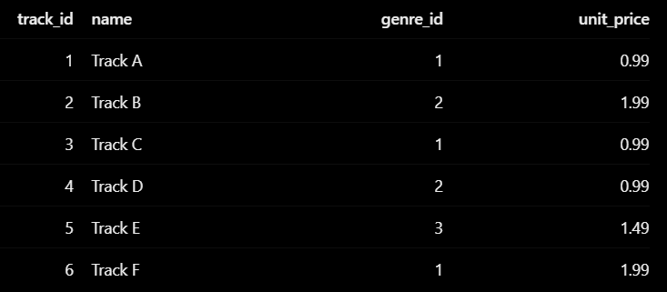
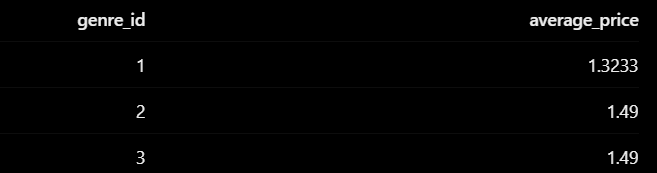
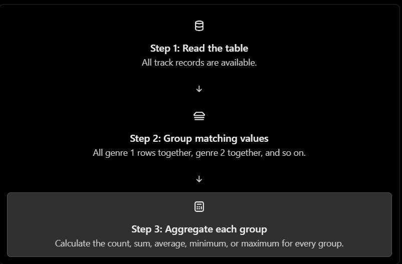
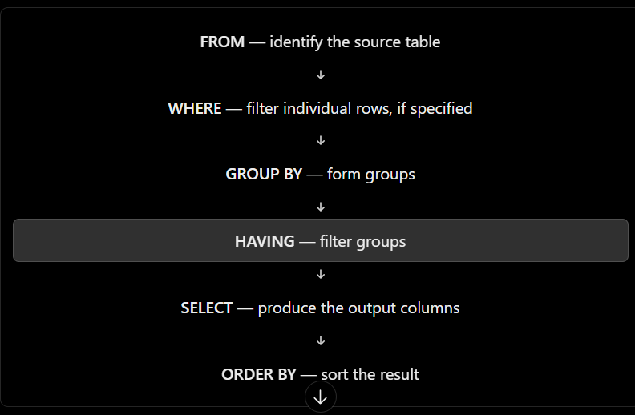

## **Grouping and Filtering (`GROUP BY` | `HAVING`)**

### **Lesson 1 - SQL `GROUP BY`**

#### **1. First, understand the problem**
Imagine our `track` table contains these sample records:


Suppose the manager asks:

"What is the average track price for each genre?"

W coould run a separate query for every genre, but that would be inefficient. Instead, use `GROUP BY`.

```SQL
SELECT genre_id, AVG(unit_price) AS average_price
FROM track
GROUP BY genre_id
ORDER BY genre_id;
```
The result from our illustrative sample data would be:


#### **2. What does `GROUP BY` do?**
Think of it as three operations:


#### **3. Combine `GROUP BY` with different aggregate functions**

We aren't limited to `AVG()`.

**Example A: Count tracks in each genre**.

```SQL
SELECT 
    genre_id,
    COUNT(*) AS track_count
FROM track
GROUP BY genre_id
ORDER BY genre_id;
```
This tells how many tracks does each genre contains.

**Example B: Find the most expensive track price in each genre**

```SQL
SELECT
    genre_id,
    MAX(unit_price) AS highest_price
FROM track
GROUP BY genre_id
ORDER BY genre_id;
```
This tells highest price of a track does each genre contains.

#### **4. The important rule: `SELECT` and `GROUP BY`**

Consider this query:
```SQL
SELECT genre_id, unit_price, AVG(unit_price)
FROM track
GROUP BY genre_id;
```

In PostgreSQL, this query is invalid because `unit_price` is neither grouped nor aggregated. Each genre may contain multiple different prices, so SQL cannot choose one price to represent the entire group.

A reliable rule is:

In a grouped query, every selected expression must generally either:
- Appear in the `GROUP BY` clause, or
- Be calculated using an aggregate function.

#### **Practice Question - 1**

**[Click here](../Practice_queries/Grouping_and_filtering.sql)**

### **What is `HAVING` in SQL?**

**Fromal definition:** `HAVING` filters groups created by `GROUP BY` based on a condition, often involving aggregate functions such as `COUNT()`, `SUM()`, or `AVG()`.

Imagine that we group all tracks by genre and count the tracks in each genre. Now we want to display only genres that contains more than 100 tracks.

That's exactly the kind of problem `HAVING` solves.

#### **1. The crucial difference: `WHERE` vs `HAVING`**

**`WHERE` - filters individual rows**

It decides which records are allowed to participate in the grouping and calculations.
```SQL
WHERE unit_price > 1.00
```
Meaning: keep only tracks priced aboved 1.00 before grouping.

**`HAVING` - filters groups**

It decides which complete groups should remain in the result.

```SQL
HAVING COUNT(*) > 100
```
Meaning: keep only genres whose group contains more than 100 qualifying tracks.

A handy rule to remember:
- `WHERE` asks: **Which rows should we consider?**

- `HAVING` asks: **Which groups should we keep?**

#### **2. Our first `HAVING` query**

Let's start with the simplest business question:

**Question:** Which genres have more than 100 tracks?

```SQL
SELECT
    genre_id
    COUNT(*) track_count
FROM track
GROUP BY genre_id
HAVING COUNT(*) > 100
ORDER_BY track_count DESC;
```

Let's break it down line by line.

| **SQL clause** | **What it does** |
|----------------|------------------|
| `FROM track` | Reads the track table. |
| `GROUP BY genre_id` | Creates group for each genre ID. |
| `COUNT(*)` | Counts the tracks in each group. |
| `HAVING COUNT(*) > 100` | Keeps only groups with more than 100 tracks.|
| `ORDER BY track_count DESC` | Sorts the reamining groups from highest count to lowest. |

Notice something important: **`HAVING COUNT(*) > 100` uses the aggregate function directly.** In PostgreSQL, don't assume we can use the `track_count` alias inside `HAVING`; Write `COUNT(*) > 100`.

#### **3. How SQL processes these clause**

For the query above, think of the logical processing sequence like this:



This is the conceptual lodical order, not a guarantee of the database's physical execution plan. PostgreSQL can optimize how it executes a query.

#### **4. Professional tips we should know**

**Tip 1:** Use `WHERE` and `HAVING` together when the question has two levels of filtering.

Suppose the question is:

"Among tracks priced above 0.99, which genres have at least 20 tracks?"

```SQL
SELECT
    genre_id,
    COUNT(*) AS track_count,
FROM track
WHERE unit_price > 0.99
GROUP BY genre_id
HAVING COUNT(*) >=20
ORDER BY track_count DESC;
```
Here, `WHERE` removes tracks priced at 0.99 or less. `GROUP BY` groups the remaining tracks. `HAVING` then keeps genres with at least 20 qualifying tracks.

**Tip 2:** `HAVING` is not restricted to `COUNT()`.

We can filter by many aggregate results:
```SQL
HAVING SUM(total) > 

HAVING AVG(unit_price) > 1.00

HAVING MIN(unit_price) >=0.99
```

the aggregate must be meaningful for the groups being evaluated.

**Tip 3:** The threshold matters.
- `HAVING COUNT(*) > 10` means 11 or more rows.

- `HAVING COUNT(*) >= 10` means 10 or more rows.

A tiny symbol can change our business conclusion.

**Tip 4:** Don't use `HAVING` just because we can.

If we're filtering individual tracks by price, use `WHERE`. If we're filtering genres based on the number of tracks they contain, use `HAVING`.

**Tip 5:** `HAVING` can be used without an explicit `GROUP BY`.

An aggregate query without `GROUP BY` can treat the filtered rows as one overall group. For example, `HAVING COUNT(*) > 100` can decide whether that single overall group appears. We'll practice this later.

### **Rela business problems**

#### **SQL Case study 1: Customer Spending Analysis**

**Business problem**
- A music store wants to identify its most valuable customers by analyzing invoice spending.

**Table: `invoice`**
- Relevant columns: `invoice_id, cutomer_id, invoice_data, total`

#### **Challenge 1 - Find high-spending customers**

**Task**: Write a query that returns:
- `customer_id`
- Total amount spent by each customer, named `total_spent`
- Only customers whose total spending is **greater than $40**
- Results ordered by total spending, highest first

**[Solutions](../Practice_queries/Real_business_problems(lev1).sql)**

#### **Challenge 2 - Find frequent customers**
Now the business wants to identify customers who make purchases frequently, not just customers who spend a lot.

**Task**: Write a query that returns:
- `customer_id`
- The number of invoices for each customers, named `invoice_count`
- the average invoice amount for each customer, named `average_invoice`
- Only customers who have **atleast 5 invoices**
- Results ordered by `invoice_count` from highest to lowest

**[Solutions](../Practice_queries/Real_business_problems(lev1).sql)**

#### **Challenge 3 - The filtering trap**
Now let's combine `WHERE`, `GROUP BY`, `HAVING` and `ORDER BY`.

The store wants to identify customers who have made **at least 3 high-value purchases**, Where a high-value purchase means an ivoice with a total greater than $5.

Write a query returning:
- `customer_id`
- Number of qualifying invoices, named `high_value_invoice_count`
- Ttoal value of those qualifying invoices, named `high_value_spending`
- Only customers with at least 3 qualifying invoices
- Results ordered by `high_value_spending`, highest first.

**[Solutions](../Practice_queries/Real_business_problems(lev1).sql)**

#### **Challenge 4 - Genre perfomance analysis**

Let's switch from customers to the store's music catalogue.

The store manager wants to find genres tha have both a sustantial number of tracks and a relatively high track price.

Use the `track` table and write a query that returns:
- `genre_id`
- Number of tracks, named `track_count`
- Average track price, named `average_track_price`
- Highest track price, named `highest_track_price`

Apply these conditions:
- Only include tracks with `unit_price >= 1.00`.
- Keep genres with more than 50 qualifying tracks **OR** an average qualifying track price greater than $1.50.
- Sort by average track price, highest first

**[Solutions](../Practice_queries/Real_business_problems(lev1).sql)**

#### **Challenge 5 - A more realistic business question**

The store wants to find customers whose **average invoice amount is greater than $6**, but only after considering invoices above $5.

Using the invoice table, return:
- customer_id
- Number of qualifying invoices, named`invoice_count`
- Average qualifying invoice amount, named `average_invoice`
- Total qualifying invoice amount, named `total_spending`

Requirements:
1. Consider only invoices where `total > 5.00`.
2. Keep customers whose average qualifying invoice amount is greater than `$6.00`.
3. Require at least **2 qualifying invoices.**
4. Sort by `average_invoice` from highest to lowest, then by `customer_id` ascending.

**[Solutions](../Practice_queries/Real_business_problems(lev1).sql)**


#### **Challenge 6 - Can we distinguish `WHERE` from `HAVING` without hints?**

A music store wants to analyze track prices by genre.

Using the `track` table, return:
- `genre_id`
- Number of tracks, named `track_count`
- Average price, named `average_price`
- total listed track prices, named `total_listed_price`

Requirements:
1. Exlcude tracks priced below $1.00.
2. Keep genres with atleast 20 qualifying tracks.
3. Of those genres, retain only ones whose average price is below $1.50.
4. Sort by average price ascending, then genre ID ascending.

**[Solutions](../Practice_queries/Real_business_problems(lev1).sql)**

#### **Challenge 7 - Customer segmentation**

The store wants to identify customers who meet **both** of these requirements:
1. The have at least 3 invoices.
2. Their total spending exceeds $40 OR their average invoice amount exceeds $8.

Use the `invoice` table. Return:
- `custoer_id`
- invoice count as `invoice_count`
- Total spending as `total_spending`
- Average invoice amount as `average_invoice`

Sort by total spending, highest first, then customer ID ascending.

