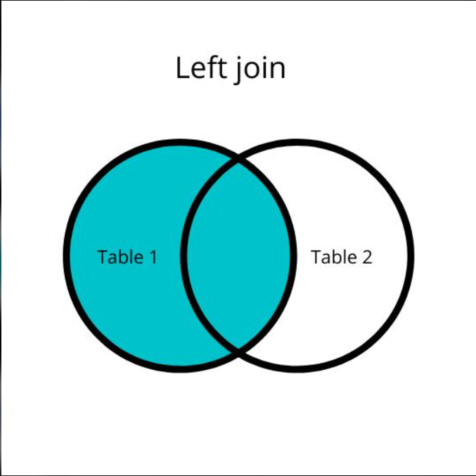
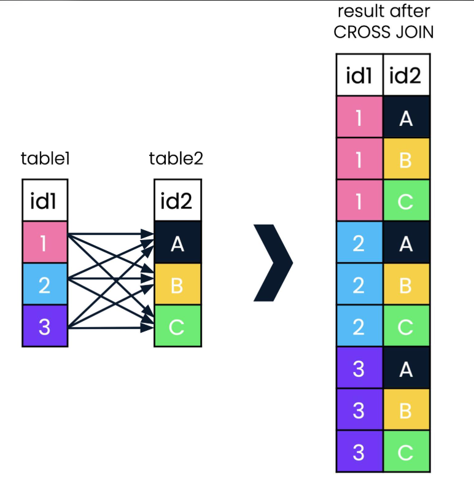

## **Joins (INNER, LEFT, RIGHT, FULL, SELF, CROSS)**

### **1. What is a JOIN?**

A **Join combines rows from two or more tables using a related column or a specified matching condition**.

Imagine a music store stores customer information and invoice information separately.


Suppose the manager asks: "Show me each invoice alongside the customer's name."

The `invoice` table contains the customer ID and invoice amount, but not the customer's name. The `customer` table contains the name. We JOIN them using `customer_id`.

```SQL
SELECT
    c.customer_id,
    c.first_name,
    i.invoice_id,
    i.total
FROM customer AS c
INNER JOIN invoice AS i
    ON c.customer_id = i.customer_id;
```
Here are three things to understand:
- `c` and `i` are table aliases, making the query shorter.
- ON `c.customer_id = i.customer_id` specifies which columns match.
- `INNER JOIN` returns only rows where a match exists in both tables.

### **2. The Six JOIN types**

#### **1. INNER JOIN**
Returns only mathcing rows from both tables.

**Use it when**: we want customers who have invoices, or invoices that belong to existing customers.


#### **2 LEFT JOIN**

Returns every row from the left table and matching rows from the right table. If no match exists, right-side columns contain `NULL`.

**Use it when**: We want every customer, including customers who have never purchased anything.



#### **3. RIGHT JOIN**

Returns every row from the right table and matching rows from the left table. If no exists, left-side columns contain `NULL`.

**Use it when**: We want every invoice, even if an invoice has no matching customer record.


#### **4. FULL OUTER JOIN**

Returns matching rows plus unmatched rows from both tables. Missing side columns are `NULL`.

**Use it when**: Reconciling two datasets and finding records that exist on only one side.

![Diagram of FULL OUTER JOIN]../Image/image8.png)

#### **5. SELF JOIN**

Joins a table to itself using separate aliases. It is a technique, not a separate JOIN keyword.

**Use it whe**: Comparing employees with their managers, or tracks with other tracks that share a composer.


#### **6. CROSS JOIN**

Produces every possible combination of rows from the two tables.

**Use it when**: Creating every combination of products and regions, or testing combinations of categories and prices.



#### **JOIN exercise**

The store wants a list of **customers who have made purchases**, showing their names and the amounts of their invoices.

Write a query using `INNER JOIN` that returns:
- `first_name`
- `last_name`
- `invoice_id`
- `total`

