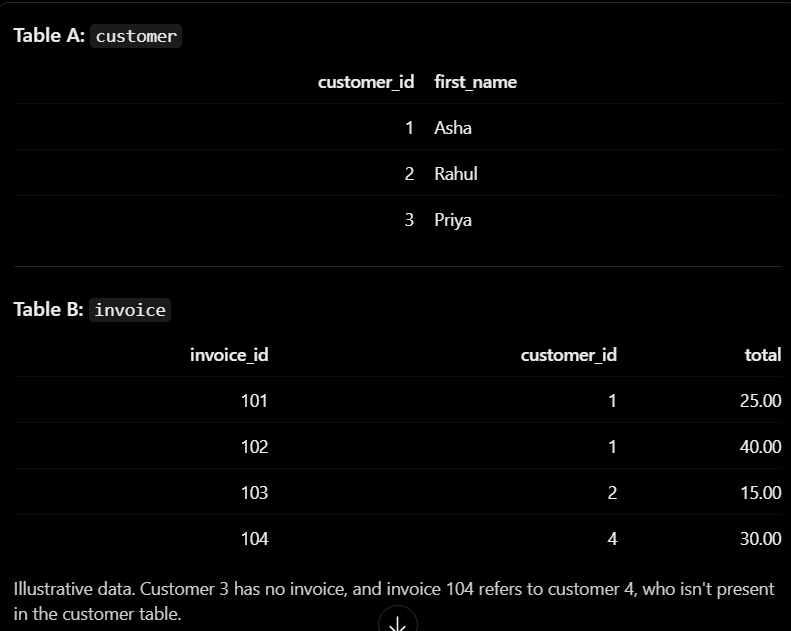
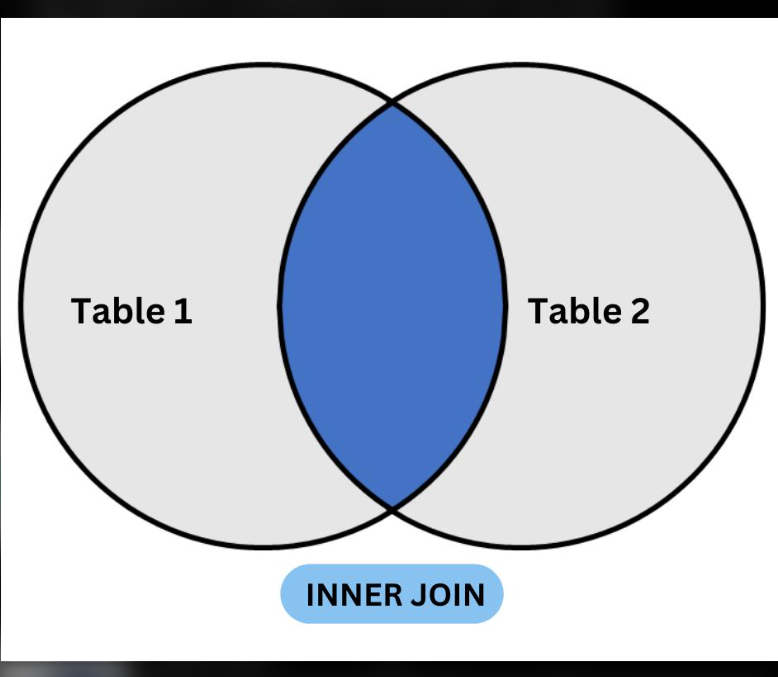
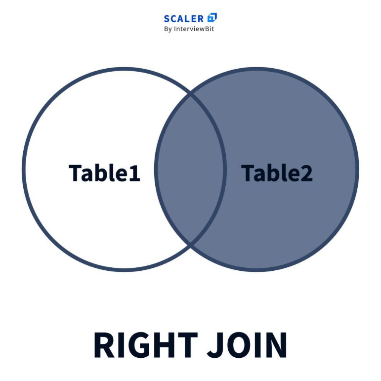
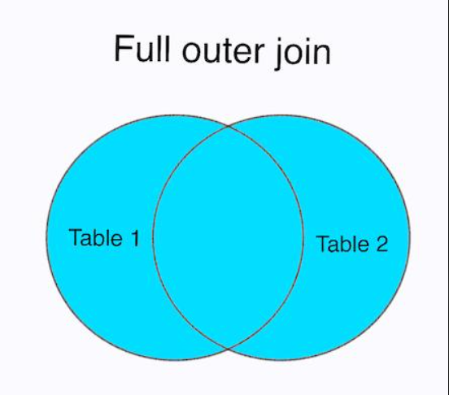
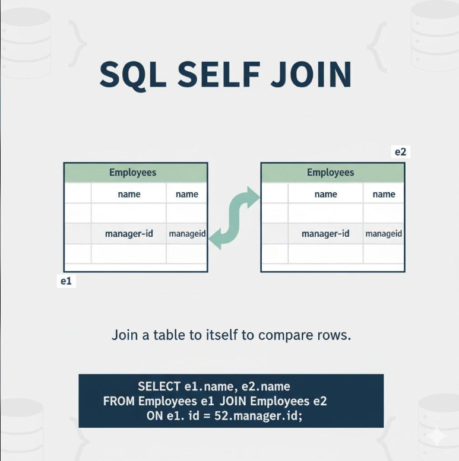

## **Joins (INNER, LEFT, RIGHT, FULL, SELF, CROSS)**

### **1. What is a JOIN?**

A **Join combines rows from two or more tables using a related column or a specified matching condition**.

Imagine a music store stores customer information and invoice information separately.



Suppose the manager asks: "Show me each invoice alongside the customer's name."

The `invoice` table contains the customer ID and invoice amount, but not the customer's name. The `customer` table contains the name. We JOIN them using `customer_id`.

```SQL
SELECT
    c.customer_id,
    c.first_name,
    i.invoice_id,
    i.total
FROM customer AS c
INNER JOIN invoice AS i
    ON c.customer_id = i.customer_id;
```
Here are three things to understand:
- `c` and `i` are table aliases, making the query shorter.
- ON `c.customer_id = i.customer_id` specifies which columns match.
- `INNER JOIN` returns only rows where a match exists in both tables.

### **2. The Six JOIN types**

#### **1. INNER JOIN**
Returns only mathcing rows from both tables.

**Use it when**: we want customers who have invoices, or invoices that belong to existing customers.



#### **2 LEFT JOIN**

Returns every row from the left table and matching rows from the right table. If no match exists, right-side columns contain `NULL`.

**Use it when**: We want every customer, including customers who have never purchased anything.


#### **3. RIGHT JOIN**

Returns every row from the right table and matching rows from the left table. If no exists, left-side columns contain `NULL`.

**Use it when**: We want every invoice, even if an invoice has no matching customer record.



#### **4. FULL OUTER JOIN**

Returns matching rows plus unmatched rows from both tables. Missing side columns are `NULL`.

**Use it when**: Reconciling two datasets and finding records that exist on only one side.



#### **5. SELF JOIN**

Joins a table to itself using separate aliases. It is a technique, not a separate JOIN keyword.

**Use it whe**: Comparing employees with their managers, or tracks with other tracks that share a composer.



#### **6. CROSS JOIN**

Produces every possible combination of rows from the two tables.

**Use it when**: Creating every combination of products and regions, or testing combinations of categories and prices.


#### **JOIN exercise**

The store wants a list of **customers who have made purchases**, showing their names and the amounts of their invoices.

Write a query using `INNER JOIN` that returns:
- `first_name`
- `last_name`
- `invoice_id`
- `total`

Use the customer and invoice tables.

**[Click here](../Practice_queries/SQL_JOINS.sql)**

#### **Next: LEFT JOIN**
Imagine the store manager asks:

_"Which customers have never made a purchase?"_

An `INNER JOIN` won't help us identify them because it excludes customers without invoices. A `LEFT JOIN` preserves every customer, even when noe matching invoice exists.

**Exercise**

Write a query that returns **only customers who have never made a purchase**.

Requirements:
- Show `customer_id`, `first_name`, and `last_name`.
- Use `LEFT JOIN`.
- EXclude customers who have a matching invoice.

**[Click here](../Practice_queries/SQL_JOINS.sql)**

#### **Next: RIGHT JOIN**
`RIGHT JOIN` is the mirror image of `LEFT JOIN`: it preserves every row from the **right-hand table**, along with matching rows from the left.

**Exercise**

Using the `customer` and `invoices` tables, write a `RIGHT JOIN` query that returns:
- `invoice_id`
- `total`
- `customer_id`
- `first_name`

**Requirement**: Keep every invoice, including invoices without a matching customer record.

**[Click here](../Practice_queries/SQL_JOINS.sql)

#### **Next: FULL OUTER JOIN**

Now imagine the store is rconciling two datasets and wants to identify **all records**, including unmatched ones on either side.

- A customer without an invoice should still appear.
- An invoice without a matching customer should still appear.
- Matched customers and invoices should appear together.

That's what `FULL OUTER JOIN` does.

**Exercise**

Write a query using `FULL OUTER JOIN` between `customer` and `invoice`.

Return:
- `customer_id`
- `first_name`
- `invoice_id`
- `total`

**Requirement**: keep all customers and all invoices, including records without a match. No `WHERE` clause is needed.

**[Click here](../Practice_queries/SQL_JOINS.sql)**

#### **SELF JOIN**

A **SELF JOIN** joins a table to itselft. It use aliases to treat the same table as two separate refrences.

Imagine an employee table:

| **employee_id** | **employee_name** | **manager_id** |
|-----------------|-------------------|----------------|
| 1 | Asha | NULL |
| 2 | Rahul | 1 |
| 3 | Priya | 1 |
| 4 | Imran | 2 |

Here, `manager_id` refers to another employee's `employee_id`.

The business question is: _Who is each employee's manager?_

```SQL
SELECT
    e.employee_id AS employee,
    m.employee_name AS manager,
FROM employee AS e
LEFT JOIN employee AS m
    ON e.manager_id = m.employee_id;
```
Why two aliases?
- `e` represents the employee.
- `m` represents that employee's manager.
- The JOIN matches each employee's `manager_id` to another employee's `employee_id`.
- `LEFT JOIN` preserves employees who don't have a manager, such as Asha.

#### **CROSS JOIN**

A **CROSS JOIN** joins **every rows from one table with every rows from another table**.

The result table contains **(n x m)** rows where _n_ is the number of rows from the first table, and _m_ is the number of rows from the other table.

**Table 1 (customer)**
| customer_id | first_name | last_name |
|-------------|------------|-----------|
| 01 | sohail | ansari |
| 02 | Rehan | habib |
| 03 | sabir | alam | 
| 04 | wasim | akram |

**Table 2 (invoice)**
| customer_id | invoice_id | total |
|-------------|------------|-------|
| 01 | 101 | 10.96 |
| 02 | 102 | 4.37 |
| 04 | 104 | 6.97 |
| 04 | 105 | 10.57 |

| customer_id | first_name | last_name | invoice_id | total |
|-------------|------------|-----------|------------|-------|
| 01 | sohail | ansari | 101 | 10.96 |
| 02 | Rehan | habib | NULL | NULL |
| 03 | sabir | alam | NULL | NULL | 
| 04 | wasim | akram | NULL | NULL |
| 04 | wasim | akram | 105 | 10.57 |


**Result of LEFT JOIN invoice ON c.customer_id = i.customer_id**

| customer_id | first_name | last_name | invoice_id | total |
|-------------|------------|-----------|------------|-------|
| 01 | sohail | ansari | 101 | 5.96 |
| 02 | Rehan | habib | 102 | 4.37 |
| 03 | sabir | alam | NULL | NULL |
| 04 | wasim | akram | 104 | 6.97 |

**Result of LEFT JOIN invoice ON c.customer_id = i.customer_id AND total >= 5**

| customer_id | first_name | last_name | invoice_id | total |
|-------------|------------|-----------|------------|-------|
| 01 | sohail | ansari | 101 | 5.96 |
| 03 | sabir | alam | NULL | NULL |
| 04 | wasim | akram | 104 | 6.97 | 

**Result of LEFT JOIN invoice ON c.customer_id = i.customer_id WHERE total >= 5**

first step (c.customer_id = i.customer_id)
| customer_id | first_name | last_name | invoice_id | total |
|-------------|------------|-----------|------------|-------|
| 01 | sohail | ansari | 101 | 5.96 |
| 02 | Rehan | habib | 102 | 4.37 |
| 03 | sabir | alam | NULL | NULL |
| 04 | wasim | akram | 104 | 6.97 |

and after that it'll filter (WHERE total >= 5)
| customer_id | first_name | last_name | invoice_id | total |
|-------------|------------|-----------|------------|-------|
| 01 | sohail | ansari | 101 | 5.96 |
| 04 | wasim | akram | 104 | 6.97


### **Batch 3: `COUNT(*)` vs COUNT(column)**

Let's understand **how `LEFT JOIN` behaves when combined with `GROUP BY` and aggregate functions**.

#### **1. First, understand the difference**

Imagine these two tables.

**Customer table**

| customer_id | first_name |
|-------------|------------|
| 1 | Sohail |
| 2 | Rehan | 
| 3 | Sabir | 

**Invoice table**

| invoice_id | customer_id | total |
|------------|-------------|-------|
| 101 | 1 | 20 |
| 102 | 1 | 30 | 
| 103 | 2 | 15 |

Customer 1 has two invoices, customer 2 has one, and customer 3 has none.

Now let's join them:
```SQL
SELECT
    c.customer_id,
    c.first_name,
    i.invoice_id,
    i.total,
FROM customer AS c
LEFT JOIN invoice AS i
    ON c.customer_id = i.invoice_id
```
| customer_id | first_name | invoice_id, | total |
|-------------|------------|-------------|-------|
| 1 | Sohail | 101 | 20 |
| 1 | Sohail | 102 | 30 |
| 2 | Rehan | 103 | 15 |
| 3 | Sabir | NULL | NULL |

Notice Sabir. Although he has no invoice, he still occupies one result row because of the `LEFT JOIN`.

Now comes the important part.

#### **2. What does each `COUNT` actually count?**

`COUNT(*)` - counts every row in the result, including a row containing `NULL` values.

For Sabir, `COUNT(*)` returns 1, because his unmatched customer row still exists.

`COUNT(i.invoice_id)` - Counts only rows where `i.invoice_id` is not `NULL`.

For Sabir, `COUNT(i.invoice_id)` returns 0 because he has no invoice ID.

Compare the results of these two queries.

**Query A**
```SQL
SELECT
    c.customer_id,
    c.first_name,
    COUNT(*) AS row_count
FROM customer AS c
LEFT JOIN invoice AS i
    ON c.customer_id = i.customer_id
GROUP BY c.customer_id, c.first_name;
```

| customer_id | first_name | row_count |
|-------------|------------|-----------|
| 1 | Sohail | 2 |
| 2 | Rehan | 1 |
| 3 | Sabir | 1 |

**Query B**

```SQL
SELECT
    c.customer_id,
    c.first_name,
    COUNT(i.invoice_id) AS invoice_count
FROM customer_id AS c
LEFT JOIN invoice AS i
    ON c.customer_id = i.customer_id
GROUP BY c.customer_id, c.first_name;
```

| customer_id | first_name | invoice_count |
|-------------|------------|---------------|
| 1 | Sohail | 2 |
| 2 | Rehan | 1 |

For counting actual invoices, `COUNT(i.invoice_id) **is the correct choice.**