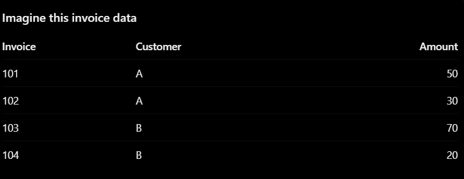
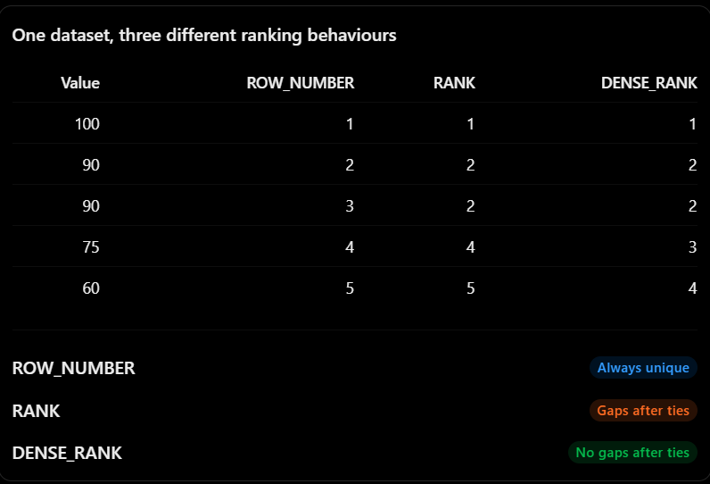

## **Wiindow Functions: `ROW_NUMBER`, `RANK`, `DENSE_RANK`, `LAG`, `LEAD`**

These functions are especially important when we start analysing business performance, customer behaviour, sales trends, rankings, and month-over-month growth.

We'll learn All five functions.

### **1. First, understand what a Window Function is**

A window function performs a calculation across a group of related rows while keeping the individual rows in the result.

This is the key idea.

We already know aggregate functions such as:

```SQL
SELECT
    customer_id,
    SUM(total) AS total_spending
FROM invoice
GROUP BY customer_id;
```

This produces one row per customer.

But suppose we want to calculate each customer's total spending and **still retain every individual invoice record**.

A normal `GROUP BY` cannot directly do that because it combines rows into groups.

A window function can. Consider this example:



**After GROUP BY customer**

| Customer | Total |
|----------|-------|
| A | 80 | 
| B | 90 | 

**After a window SUM**

| Invoice | Customer | Amount | Customer total |
|=========|==========|========|================|
| 101 | A | 50 | 80 |
| 102 | A | 30 | 80 |
| 103 | B | 70 | 90 |
| 104 | B | 20 | 90 |

That's the fundamental difference.
- `GROUP BY` reduces the number of rows.
- Window functions calculate across related rows without collapsing them.

### **2. Understanding the OVER() clause**

Window function use the `OVER()` clause to define the window over which the calculation operattes.

Example:

```SQL
SELECT
    invoice_id,
    customer_id,
    total,
    SUM(total) OVER (
        PARTITION BY customer_id
    ) AS customer_total
FROM invoice;
```

Let's understand each part.

| Component | Meaning |
|===========|=========|
| `SUM(total)` | Calculate the sum |
| `OVER()` | Perform it as window calculation |
| `PARTITION BY customer_id` | Create a separate window for each customer |

#### **What does PARTITION BY mean?**

It divides the records into logical groups for calculation, without physically combining them.

For example:
- Customer A gets one window.
- Customer B gets another window.
- Customer C gets another window.

The calculation happens independently inside each window.

An important distinction: `PARTITION BY` does not necessarily sort the records. That's the job of `ORDER BY` inside `OVER()`.

### **3. The general syntax**

```SQL
FUNCTION_NAME() OVER (
    PARTITION BY column_name
    ORDER BY column_name
)
```

We don't alway need both clauses.
- `PARTITION BY` is optional
- `ORDER BY` is optional, depending on the function intended calculation.
- `OVER()` is essential for a window function.

Now let's learn the five functions individually.

### **4. ROW_NUMBER() — Give every row a unique number**

`ROW_NUMBER()` assigns a sequential number to every row within a window.

Why does it exist?

Imagine a company wants to list its customers from highest spending to lowest spending. It may also want identify the first, second, third, and subsequent customers.

Example:

```SQL
SELECT
    customer_id,
    invoice_id,
    total,
    ROW_NUMBER() OVER (
        ORDER BY total DESC
    ) AS row_num
FROM invoice;
```

Suppose the result look like this:

| Customer | Invoice | Total | Row number |
|----------|---------|-------|------------|
| A | 101 | 100 | 1 |
| B | 102 | 90 | 2 | 
| C | 103 | 90 | 3 |
| D | 104 | 75 | 4 |
| E | 105 | 60 | 5 |

**Notice something interesting**: customer B and C both have an invoice of 90, but they receive different row numbers.

Why?

Because `ROW_NUMBER()` always assigns a unique sequential number to each row.

**Business application:** Suppose an e-commerce company wants to retrieve the lastest transaction for every customer.

```SQL
WITH ranked_invoices AS (
    SELECT
        customer_id,
        invoice_id,
        invoice_date,
        total,
        ROW_NUMBER() OVER (
            PARTITION BY customer_id
            ORDER BY invoice date DESC, invoice_id DESC
        ) AS row_num
    FROM invoice
)

SELECT * 
FROM ranked_invoices
WHERE row_num = 1;
```

What's happening?
1. `PARTITION BY customer_id` creates a separate window for each customer.
2. `ORDER BY invoice_date DESC` Puts the newest invoice first.
3. `ROW_NUMBER()` assigns 1 to the newest invoice for each customer.
4. The outer query retrieves only rows numbered 1.

This is a common SQL technique for finding the latest record per entity.

### **5. RANK() — Rank records while respecting ties**

`RANK()` assigns rankings based on ordering, but records with equal values recieve the same rank.

Let's use the same example.


| Customer | Invoice | Total | Row number | RANK|
|----------|---------|-------|------------|-----|
| A | 101 | 100 | 1 | 1 |
| B | 102 | 90 | 2 | 2 |
| C | 103 | 90 | 3 | 2 |
| D | 104 | 75 | 4 | 4 |
| E | 105 | 60 | 5 | 5 |

Notice the difference?

B and C both have a total of 90. Therefore, both receive rank 2.

But the next customer receives rank 4, not rank 3.

Because `RANK()` accounts for the number of rows that came before a particular rank.

Two customers occupy the second position, so the next position becomes fourth.

Think of a school competition:
- Two students tie for second place.
- The next student gets fourth place.

That's exactly how `RANK()` behaves.

```SQL
SELECT
    customer_id,
    invoice_id,
    total,
    RANK() OVER (
        ORDER BY total DESC
    ) AS invoice_rank
FROM invoice;
```

**Business application:** Ranking salespeople by revenue, where employees with equal revenue should share the same position.

### **6. DENSE_RANK() — Rank without gaps**

`DENSE_RANK()` assigns the same rank to tied values but does not leave gaps in subsequent rankings.

Using our example.

| Customer | Invoice | Total | Row number | RANK|
|----------|---------|-------|------------|-----|
| A | 101 | 100 | 1 | 1 |
| B | 102 | 90 | 2 | 2 |
| C | 103 | 90 | 3 | 2 |
| D | 104 | 75 | 4 | 3 |
| E | 105 | 60 | 5 | 4 |

Here, the difference becomes clear.
- `RANK()` skips a position after a tie.
- `DENSE_RANK()` does not skip a position after a tie.

Think of ranking product categories by sales:

| Category | Revenue | Dense rank |
|----------|---------|------------|
| Electronics | 100,000 | 1 | 
| Clothing | 80,000 | 2 | 
| Furniture | 80,000 | 2 |
| Books | 50,000 | 3 | 

This is useful when you want to identify the top three distinct revenue levels, rather than the top three row positions.

**Compare all three together**



A common mistake is thinking these functions are interchangeable. They aren't. The correct choice depends on the business meaning of the ranking.

### **7. LAG() — Look at a previous row**

Now we're moving from ranking to something particularly useful in time-series analysis.

`LAG()` allows us to access a value from a previous row withing the current window.

Why does this exist?

Suppose a company wants to compare its monthly revenue with the previous month's revenue.

Without `LAG()`, we might need to join a table with itself or create more complicated subqueries.

`LAG()` makes this much simpler.

Imagine the monthly revenue data:
| Month | Revenue | 
|-------|---------|
| Jan | 10,000 |
| Feb | 12,000 |
| Mar | 15,000 |
| Apr | 13,000 |

We want to compare each month with the previous month.

```SQL
SELECT
    month,
    revenue,
    LAG(revenue) OVER (
        ORDER BY month
    ) AS previouos_month_revenue
FROM monthly_sales;
```

Result:

| Month | Revenue | Previous revenue |
|-------|---------|------------------|
| Jan | 10,000 | NULL |
| Feb | 12,000 | 10,000 |
| Mar | 15,000 | 12,000 |
| Apr | 13,000 | 15,000 |

Notice:
- Jan has no previous row, so its result is `NULL`.
- Feb retrieves Jan's revenue.
- Mar retrieves Feb's revenue.
- Apr retrieves Mar's revenue.

That's `LAG()`.

**Understanding its syntax**

```SQL
LAG(column_name, offset, default_value)
OVER (
    PARTITION BY ...
    ORDER BUY ...
)
```
The arguments:

| Argument | Purpose |
|----------|---------|
| `column_name` | Which value do you want to retrive? |
| `offset` | How many rows backward? |
| `default_value` | What to return if that previous row doesn't exist? |

For example:

```SQL
LAG(revenue, 2, 0) OVER (
    ORDER BY month
)
```

This retrives the revenue from two rows earlier. If that row doesn't exist, it returns 0.

The default offset is 1, and the default value is `NULL`.

#### **Practical business application: Month-over-month revenue growth**

This is where `LAG()` becomes especially powerful.


SQL:

```SQL
WITH monthly_sales AS (
    SELECT
        DATE_TRUNC('month', invoice_date)::date AS sales_month,
        SUM(total) AS revenue
        FROM invoice
        GROUP BY DATE_TRUNC('month', invoice_date)
),

Sales_comparison AS (
    SELECT
        sales_month,
        revenue,
        LAG(revenue) OVER (
            ORDER BY sales_month
        ) AS previous_revenue
    FROM monthly_sales
)

SELECT
    sales_month,
    revenue,
    previous_revenue,
    ROUND(
        (revenue - previous_revenue)
        / NULLIF(previous_revenue, 0) * 100,
        2
    ) AS growth_percentage
FROM sales_comparison
ORDER BY sales_month;
```

This query calculates monthly revenue and compares it with the previous available month. 

Notice how use `NULLIF(previous_revenue, 0) to avoid division by zero.

One important detal: if a month has no invoices, it won't appear in `monthly_sales`. In that case, `LAG()` compares against the previous available month, not necessarily the previous calendar month. We'll explore how to handle missing months later.

### **8. LEAD() — Look at a future row**

`LEAD()` retrives a value from a subsequent row within the current window.

It is essentially the opposite of `LAG()`.
- `LAG()` looks backward.
- `LEAD()` looks forward.

Example:

```SQL
SELECT
    month,
    revenue,
    LEAD(revenue) OVER (
        ORDER BY month
    ) AS next_month_revenue
FROM monthly_sales;
```

Result:

| Month | Revenue | Previous revenue |
|-------|---------|------------------|
| Jan | 10,000 | 12,000 |
| Feb | 12,000 | 15,000 |
| Mar | 15,000 | 13,000 |
| Apr | 13,000 | NULL |

April has no following row, so it returns `NULL`.

**Business applications:**

- Comparing current sales with next month's sales.
- Analysing changes between consecutive transactions.
- Finding the next purchase made by a customer.
- Studying the time between customer activities.

For example, to find each customer's next invoice:
```SQL
SELECT
    customer_id,
    invoice_id,
    invoice_date,
    LEAD(invoice_date) OVER (
        PARTITION BY customer_id
        ORDER BY invoice_date, invoice_id
    ) AS next_invoice_date
FROM invoice;
```

This gives us the next invoice date for each customer.