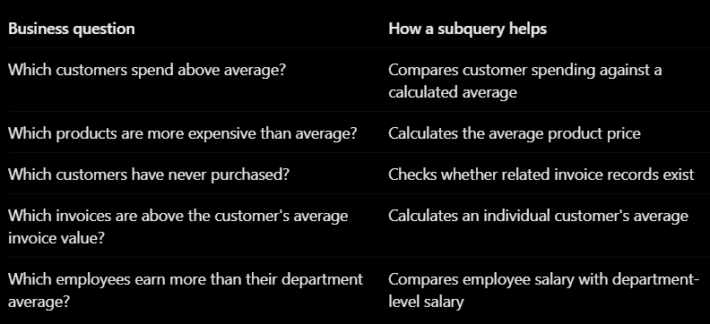
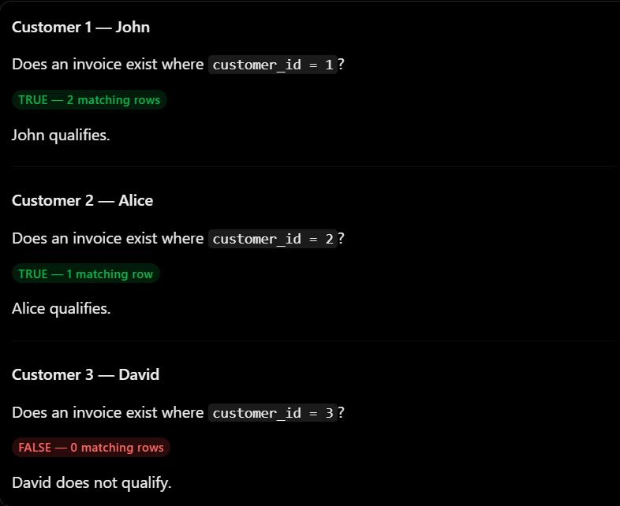

<h1 style='text-align: center'><b>SQL Subqueries — From Fundamentals to Advanced</b></h1>

### **1. What exactly is a subquery?**

**Simple definition:** A subqeury is a SQL query written inside another SQL query.

Think of it as asking one question to answer another question.

Imagine a business manager asks:

> Which customers have spent more than the average customer?

To answer this, we need two things:
- Calculate the average amount spent by each customer.
- Find customers whose spending is higher than the average.

The second task depends on the result of the first task.

A subquery allows us to place that first calculation inside the main query.

### **2. Why do subqueris exist?**

Without subqueries, we often have to perform multiple separate operations.

For example:
- Run one query to calculate average revenue.
- Remember the result.
- Write another query using that result.

A subquery lets SQL perform these operations together.

This is particularly useful in business analysis:



The key idea: **A subquery helps SQL use the result of one calculation as an input to another calculation.**

### **3. Understanding the structure**

Let's start with the simplest possible example.

Suppose we want to find invoices whose total is greater than the average invoice total.

```SQL
SELECT
    invoice_id,
    customer_id,
    total
FROM invoice
WHERE total > (
    SELECT AVG(total)
    FROM invoice
);
```

Let's break this down.

**Inner query —calculates the average**

```SQL
SELECT AVG(total)
FROM invoice;
```
**Outer query — finds invoices above that average**

```SQL
SELECT invoice_id, customer_id, total
FROM invoice
WHERE total > -- Result of the subquery;
```

#### **How SQL logically process this example**

1. The inner query calculates `AVG(total)`.

2. It returns a single value.

3. The outer query compares each invoice's `total` against that value.

4. Only invoices satisfying the condition are returned.

One importan distinction: this is a useful way to understand the dependency between queries. The database's actual execution plan may optimise or rearrange the work.

### **4. The three major types of subqueries**

We'll classify subqueries by the kind of result they return.

#### **1. Scalar subquery**

**_One Value_**

Returns one row and one column.

Example: Average invoice value.

```SQL
SELECT AVG(total)
FROM invoice;
```

#### **2. Multiple-row subquery**

**_Multiple Values_**

Returns multiple rows, usually used with operators such as `IN`, `ANY`, or `ALL`.

Example: List of customer IDs from Germany.

```SQL
SELECT customer_id
FROM customer
WHERE country = 'Germany';
```

#### **3. Correlated subquery**

**_Depends on Outer Query_**

Refers to a column from the query and is logically evaluated in realtion to each outer row.

Example: Compare each invoice with that customer's average invoice value.

```SQL
SELECT i.*
FROM invoice AS i
WHERE i.total > (
    SELECT AVG(i2.total)
    FROM invoice AS i2
    WHERE i2.customer_id = i.customer_id
);
```

We'll study all three properly. Today, let's make sure the first two are crystal clear before moving to correlated subqueries.

### **5. Scalar subqueries — One value, one purpose**

A scalar subquery returns a single value: one row and one column.

Why is this useful?

Because SQL can use that one value in comparisons, calculations, and expressions.

**Example A: Invoices above average**

```SQL
SELECT
    invoice_id,
    customer_id,
    total
FROM invoice
WHERE total > (
    SELECT AVG(total)
    FROM invoice
);
```

**Example B: Products with a price above the maximum price of a particular category**

Imagine a product databse with a `product` table and a `category_id` column.

```SQL
SELECT
    product_id,
    product_name,
    unit_price
FROM product
WHERE unit_price > (
    SELECT MAX(unit_price)
    FROM product
    WHERE category_id = 3
);
```

The inner query calculates the maximum unit_price in category 3. The outer query finds products priced above that value.

**Important rules**

- Exactly on column.
- No more than one row.

What happens if it returns multiple rows?

PostgreSQL raises an error becuase a comparison such as `price > (...)` expects a single value.

What if it returns zero rows?

The scalar subquery produces `NULL`. Comparisons against that `NULL` generally evaluete to unknown, so rows are not selected by the `WHERE` condition.

**Remember**: `AVG()`, `MAX()`, `MIN()`, and `SUM()` without `GROUP BY` normally produce one row, even when there are no qualifying non-NULL values. The result may be `NULL`.

### **6. Multiple-row subqueries — working with a set of values**

Now let's understand a different situation.

Suppose we want to find all invoices belonging to customers from Germany.

We can write:
```SQL
SELECT
    invoice_id,
    customer_id,
    total
FROM invoice
WHERE customer_id IN (
    SELECT customer_id
    FROM customer
    WHERE country = 'Germany'
);
```

The inner query returns a list of customer IDs.

For example, imagine it returns:

```text
2
5
8
11
```

The outer query then checks whether each invoice's `customer_id` belongs to that list.

**Why use `IN`?**

Becuase `=` expects a single value, while `IN` can compare against multiple values.

Compare:

```SQL
WHERE customer_id = 2
```
With:
```SQL
WHERE customer_id IN (2, 5, 8, 11)
```

The subquery generates that list dynamically.

**Another example: Customers who have made purchase**

```SQL
SELECT
    customer_id,
    fist_name,
    last_name
FROM customer
WHERE customer_id IN (
    SELECT customer_id
    FROM invoice
);
```
The inner query retrieves customer IDs that appear in the invoice table.

The outer query retrieves the corresponding customer details.

Notice that this is similar to an INNER JOIN, but the two approaches express the question differently:
- `JOIN` combines columns from related tables.
- `IN` checks whether a value belongs to a set.

Neither is automatically better in every situation. Choose based on the question and the result we need.

### **7. A very important distinction: `IN` vs `NOT IN`**

`IN` checks wheter a value exists in a set.

`NOT IN` checks wheter a value does not exist in a set.

For example, customers who have never made a purchase:

```SQL
SELECT
    customer_id,
    first_name,
    last_name
FROM customer
WHERE customer_id NOT IN (
    SELECT customer_id
    FROM invoice
);
```

This works when the subquery's returned customer IDs contain no `NULL`.

But there's a trap. 

If the subquery returns a `NULL`, `NOT IN` can produce unexpected results because SQL uses three-value logic: TRUE, FALSE, and UNKNOWN.

For exclusion problems, we generally should learn `NOT EXISTS` as well. We'll study it in depth when we reach correlated subqueries.

For now, remember:
- `IN` is useful for checking membership.
- `NOT IN` needs care when NULL values are possible.
- `NOT EXISTS` is often a safer expression of "no matching record exists."

### **8. First practical test**

**[Click here](../Practice_queries/Subqueries.sql)**

### **9. `EXISTS` and `NOT EXISTS`**

The easiest way to understand them is to stop thinking about retrieving data and start thinking about asking a question:

**"Does at least one matching record exist?"**

#### **1. What is `EXISTS`**

`EXISTS` checks whether a subquery returns at least one row.
- If the suquery returns one or more rows -> `EXISTS` is TRUE.
- If the subquery returns zero rows -> `EXISTS` is FALSE.

It doesn't matter what values the subquery returns. We only care whether a matching row exists.

**Syntax:**
```SQL
SELECT columns
FROM table_name
WHERE EXISTS (
    SELECT 1
    FROM another_table
    WHERE condition
);
```

**Step 1: Understand it with a business example**

We have two tables:

**Customer**
| customer_id | first_name |
|-------------|------------|
| 1 | John |
| 2 | Alice | 
| 3 | David |

**Invoice**
| invoice_id | customer_id | total |
|------------|-------------|-------|
| 101 | 1 | 25 |
| 102 | 1 | 40 |
| 103 | 2 | 15 | 

Now, our business question is:

_"Find customers who have never made at least one purchase."_

We can write:
```SQL
SELECT
    c.customer_id,
    c.first_name
FROM customer AS c
WHERE EXISTS (
    SELECT 1
    FROM invoice AS i
    WHERE i.customer_id = c.customer_id
);
```

**Step 2: How deos SQL evaluate this?**

Think of SQL checking each customer individually.

